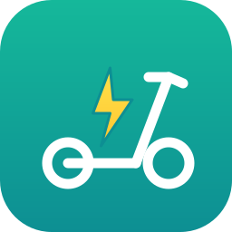

<p align="center">
  
</p>

<h1 align="center">Segway Ninebot — Home Assistant</h1>

<p align="center">
  Integración local por BLE para patinetes <b>Segway-Ninebot</b>.<br>
  Batería, velocidad, kilometraje, temperaturas y más — sin nube, y <b>conviviendo con la app oficial</b>.
</p>

---

## Qué hace

Lee por Bluetooth los datos de tu patinete y los expone como sensores en Home
Assistant. Todo **local** (sin servidores de Segway) y **solo lectura**: no puede
alterar el emparejamiento ni accionar el vehículo.

Verificado contra una unidad real **Ninebot KickScooter F3 Pro** (gen2, authV2).
La arquitectura es de la familia Encryption2, así que apunta a servir al resto de
kickscooters modernos (F2, F-series, Max G2/G3, GT…); cada modelo expone un
subconjunto de registros y la integración **lee lo que responde y omite el resto**.

| | |
|---|---|
| Sensores | batería, velocidad, kilometraje total y del trayecto, autonomía, temperatura, tiempo de conducción/encendido, modo, códigos de error/aviso, BMS (tensión, corriente, carga, temperatura) |
| Control | interruptor *Sondeo BLE* para ceder el radio a la app |
| Clase | `local_polling`, solo lectura |

## Convivencia con la app oficial (por diseño)

El patinete tiene **un único slot de contraseña** de sesión. Generar una nueva
(comando `SET_PWD`) desemparejaría la app de Segway. Por eso esta integración
**estructuralmente no puede** emitir `SET_PWD`: no existe su constructor y una
allowlist (`PRE_COMM`, `AUTH`, `READ`) bloquea cualquier otra cosa antes de
cifrarla. Reutiliza la contraseña que la app ya tiene → las dos comparten
credencial y ninguna desempareja a la otra.

Segundo límite, físico: el módulo BLE acepta **un central a la vez**. Cada sondeo
conecta, lee y **se desconecta** (5 min por defecto); hay un interruptor para
pausarlo mientras conduces.

## Instalación (HACS)

1. HACS → ⋮ → Repositorios personalizados → `https://github.com/camilo-sx/ha-segway-ninebot`, tipo *Integration*.
2. Instala **Segway Ninebot** y reinicia Home Assistant.
3. Ajustes → Dispositivos y servicios → Añadir integración → **Segway Ninebot**.

Necesitas un adaptador Bluetooth (o un [Bluetooth Proxy ESPHome](https://esphome.io/projects/?type=bluetooth))
a pocos metros del patinete.

## La contraseña de sesión

Es un secreto de 16 bytes por patinete que la app genera al emparejar y **no
viaja por la nube** (lo confirmó el reverse engineering del APK: la clave se
deriva en el dispositivo). Para que Home Assistant use **la misma** que la app,
hay que leerla una vez. Herramienta incluida:

```bash
# Copia local del iPhone SIN cifrar (Finder) → extrae la contraseña existente
python3 tools/extract_creds.py --backup --sn <TU_SERIE> --out creds.json
```

Pégala en el formulario de alta. No cambia nada en la app: lee la credencial que
ya existe. (En el repo hay también `tools/bt_capture.sh` + `decode_capture.py`
para obtenerla capturando un re-emparejamiento por USB, como alternativa.)

## Cómo funciona

| | |
|---|---|
| Familia | Proto2, sync `0x5A 0xA5`, cifrado **Encryption2** (AES-128 CTR no estándar + CBC-MAC 4 B) |
| Clave | `SHA-1(key1‖key2)[:16]`; handshake `PRE_COMM → AUTH` (nunca `SET_PWD`) |
| Transporte | Nordic UART (`6e400002/3-b5a3-…`) |
| Registros | placa `vcu` + BMS; decodificados y escalados en `nb/protocol.py` |

Criptografía y protocolo portados y verificados contra hardware real; ver
[`NOTICE`](NOTICE) para las atribuciones (Apache-2.0 y MIT).

```bash
# Suite de pruebas (sin hardware): crypto, protocolo, camino de lectura, decoder
for t in tests/test_*.py; do python3 "$t"; done
```

## Estado

Protocolo, criptografía y **camino completo de lectura** verificados (incluida la
decodificación contra una trama real del patinete y una simulación extremo a
extremo). Lo único que falta para conectar en vivo es la contraseña de sesión
(paso de arriba). La capa cloud para acciones de control (`ident`) está
documentada y reservada para una fase futura — ver [`STACK_PLAN.md`](STACK_PLAN.md).

## Aviso legal

Proyecto **no oficial**, sin relación con Segway Inc. ni Ninebot; las marcas son
de sus titulares y se usan solo para identificar el hardware. El icono es una
ilustración genérica, no el logotipo de Segway. Ingeniería inversa con fines de
interoperabilidad. Úsalo solo con vehículos de tu propiedad.
